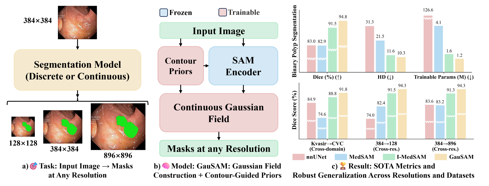
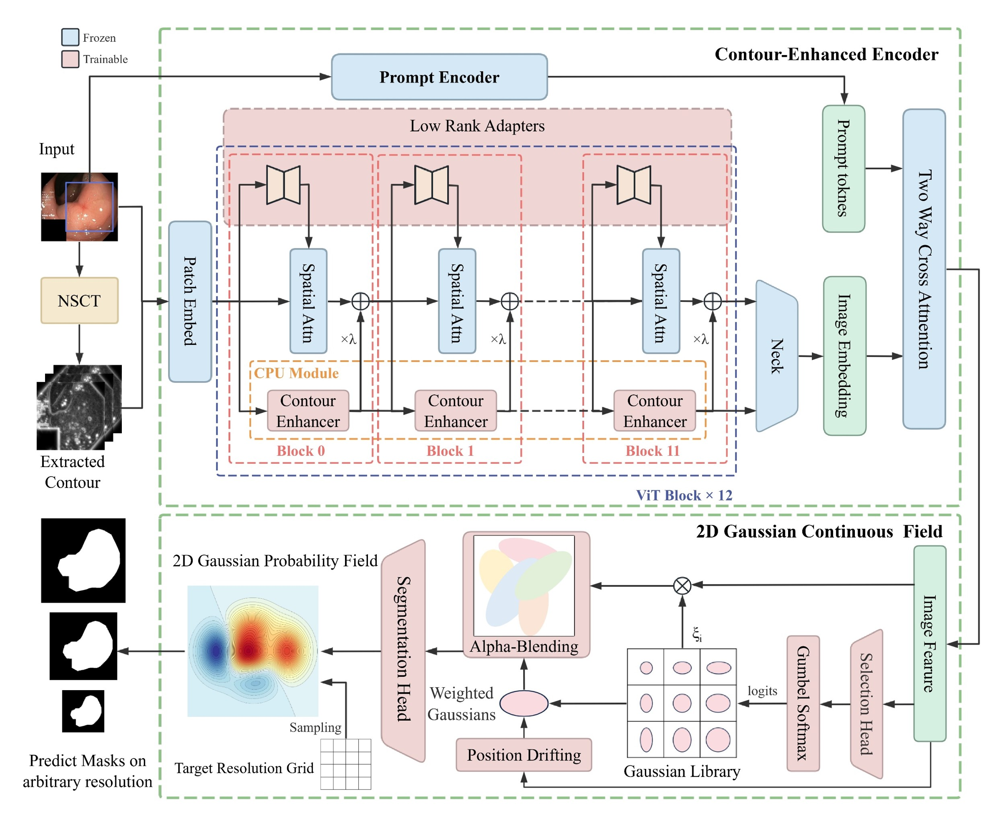

# 🧠 GauSAM: Contour-Guided 2D Gaussian Fields for Multi-Scale Medical Image Segmentation with Segment Anything

<p align="center">
  <a href="https://neurips.cc/virtual/2025/loc/san-diego/poster/119713"></a>
  <a href="https://neurips.cc/virtual/2025/loc/san-diego/poster/119713"></a>
  <a href="https://github.com/Quinten-Wu504/GauSAM/stargazers"></a>
  <a href="LICENSE"></a>
</p>

> [GauSAM: Contour-Guided 2D Gaussian Fields for Multi-Scale Medical Image Segmentation with Segment Anything](https://neurips.cc/virtual/2025/loc/san-diego/poster/119713)<br>
> Jinxuan Wu<sup>&#42;</sup>, Jiange Wang<sup>&#42;</sup>, Dongdong Zhang<sup>†</sup><br>
> School of Computer Science and Technology, Tongji University<br>
> NeurIPS 2025<br>
> <sup>&#42;</sup> Equal contribution. <sup>†</sup> Corresponding author.

## Overview

GauSAM integrates **contour-guided 2D Gaussian probability fields** into the Segment Anything Model for multi-scale medical image segmentation. Segmentation masks are parameterized as continuous probability fields of learnable 2D Gaussian primitives, enabling **resolution-agnostic mask generation**: GauSAM processes a single image and produces segmentation masks at user-specified resolutions. Contour priors derived from the Non-Subsampled Contourlet Transform (NSCT) enhance the SAM image encoder and guide the spatial distribution of Gaussian primitives, improving boundary fidelity and structural coherence.



The overview illustrates resolution-agnostic mask generation, the architecture and workflow of GauSAM, and the results reported in the paper across in-domain, cross-domain and cross-resolution settings.

### Framework



GauSAM consists of two principal stages: **Contour-Enhanced Encoding** and **2D Gaussian Continuous Field Decoding**. The input image is processed by a SAM image encoder augmented by NSCT-based contour extraction and Contour Propagation Units (CPU). A continuous Gaussian field built from learnable 2D primitives then produces a resolution-agnostic segmentation mask. A Contour-Guided Position Drift module adjusts the location of each primitive using contour-aware offsets, enhancing boundary alignment without compromising semantic coherence.

Red-colored modules indicate trainable components, including LoRA-adapted layers and newly proposed modules; blue modules denote frozen parts from the SAM-ViT-B backbone.

## Installation

Run from the project directory on a machine with an NVIDIA GPU:

```bash
git clone https://github.com/Quinten-Wu504/GauSAM.git
cd GauSAM
conda env create -f environment.yml
conda activate gausam
```

The environment includes Python 3.12, PyTorch 2.8.0 and CUDA 12.8 wheels. Use an NVIDIA driver compatible with CUDA 12.8.

## Preparation

Training and testing automatically check and download missing resources. No separate preparation command is needed.


| Resource                      | Default location                |
| ----------------------------- | ------------------------------- |
| Sessile-Kvasir                | `data/sessile-Kvasir/`          |
| CVC, for cross-domain testing | `data/CVC/`                     |
| SAM ViT-B weights             | `sam_ckpt/sam_vit_b_01ec64.pth` |

Sessile-Kvasir uses a fixed split of **118 training, 39 validation and 39 test images**. CVC is downloaded when cross-domain testing is requested.

### Manual Download

Both dataset archives are available in our [Google Drive dataset folder](https://drive.google.com/drive/folders/1_9DlD9224YU5zcWGZ2sDCFpV2tzUHwcC):

- [Sessile-Kvasir ZIP](https://drive.google.com/file/d/1uQ6fTLht97EDudSxcVljpQwixUjJDQqP/view)
- [CVC ZIP](https://drive.google.com/file/d/1aoFKT6yn4ZhGMkGPLYSVtwk3cJnXuCum/view)

Alternatively, place `sessile-Kvasir.zip` and `CVC.zip` in `data/.cache/`, keeping their original filenames. No manual extraction is needed: the training and testing commands check the archives and prepare the dataset directories automatically. CVC is only needed for cross-domain testing.

Download the [SAM ViT-B checkpoint](https://dl.fbaipublicfiles.com/segment_anything/sam_vit_b_01ec64.pth) and save it as `sam_ckpt/sam_vit_b_01ec64.pth`. On Linux, you can run:

```bash
mkdir -p sam_ckpt
curl -fL --retry 3 https://dl.fbaipublicfiles.com/segment_anything/sam_vit_b_01ec64.pth -o sam_ckpt/sam_vit_b_01ec64.pth
```

Then run the training or testing commands below as usual. The SAM ViT-B checkpoint initializes training; testing uses your trained GauSAM checkpoint.

## Training

Train on Sessile-Kvasir with the provided configuration:

```bash
python main.py --config configs/polyp.json --task_name polyp
```

Checkpoints and logs are saved to `outputs/polyp/`. Training settings are in `configs/polyp.json`; early stopping uses a patience of 20 validation events. Use a different `--task_name` to start another run.

Resume interrupted training:

```bash
python main.py --resume outputs/polyp/checkpoint_latest.pth --task_name polyp
```

## Testing

Evaluate the checkpoint with the best validation Dice:

```bash
python main.py --mode eval --resume outputs/polyp/checkpoint_best_dice.pth --task_name polyp_test --save_pic
```

Dice and HD results are saved to `outputs/polyp_test/metrics.json`. With `--save_pic`, predicted masks are saved under `outputs/polyp_test/predictions/`.

### Cross-Resolution

Keep the input at 384 × 384 and evaluate outputs at 128 × 128 and 896 × 896:

```bash
python main.py --mode eval --resume outputs/polyp/checkpoint_best_dice.pth --label_size 128 --task_name polyp_test_128
python main.py --mode eval --resume outputs/polyp/checkpoint_best_dice.pth --label_size 896 --task_name polyp_test_896
```

To evaluate all three output sizes (128, 384 and 896) on Linux:

```bash
bash scripts/test/test_multiscale.sh
```

### Cross-Domain

Evaluate the trained model on CVC without retraining. Missing data are downloaded automatically.

```bash
python main.py --mode eval --dataset cvc --resume outputs/polyp/checkpoint_best_dice.pth --task_name polyp_to_cvc
```

## Custom Dataset

Provide an already prepared directory with matching image/mask filenames. Masks must use 0/1 or 0/255:

```text
my_dataset/
├── train/
│   ├── images/
│   └── masks/
├── val/
│   ├── images/
│   └── masks/
└── test/
    ├── images/
    └── masks/
```

```bash
python main.py --config configs/polyp.json --data_path /path/to/dataset --task_name custom
python main.py --mode eval --data_path /path/to/dataset --resume outputs/custom/checkpoint_best_dice.pth --task_name custom_test
```

Training uses `train` and `val`; testing uses `test`. Pass the same dataset directory when training and testing.

## Citation

```bibtex
@inproceedings{wu2025gausam,
  title={GauSAM: Contour-Guided 2D Gaussian Fields for Multi-Scale Medical Image Segmentation with Segment Anything},
  author={Wu, Jinxuan and Wang, Jiange and Zhang, Dongdong},
  booktitle={Advances in Neural Information Processing Systems},
  year={2025},
  url={https://neurips.cc/virtual/2025/loc/san-diego/poster/119713}
}
```

## Acknowledgements

This implementation builds on [Segment Anything](https://github.com/facebookresearch/segment-anything), [GaussianSR](https://github.com/tljxyys/GaussianSR) and [MONAI](https://github.com/Project-MONAI/MONAI).
